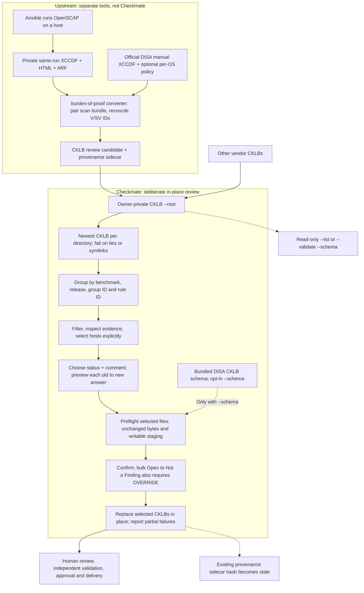

# Checkmate

A terminal editor for STIG Viewer `.cklb` checklists. It reads CKLB JSON, so Cisco IOS, RHEL, and other benchmarks all get the same treatment. Apparently the paperwork is the one platform everyone agreed to standardize.

Checkmate edits checklist answers. It does **not** run scans, assess a host, approve a control, or make an incorrect answer correct by displaying it in a handsome terminal.

## Primary workflow



Start with `--list` to inspect the discovered files; `--validate --schema PATH` is an optional **read-only** check, not an edit or a signoff. In the editor, no hosts start selected. Filter and inspect each host, explicitly select only those sharing a justified answer, preview the exact old → new status and comment, then confirm. A common control ID is not a fleet-wide finding. Checkmate does not regenerate the converter's provenance, make a multi-file edit transactional, or replace a human approval process. For private copied RHEL 7–10 practice inputs, see [offline examples](docs/OFFLINE-EXAMPLES.md); that guide is packaged, but its Git-ignored inputs are not.

## Run locally

You need Go to build it. The resulting binary, sensibly, does not need Go to supervise it. The build lives in the ignored `release/` directory:

```sh
./scripts/package.sh 0.4.1
./release/checkmate --root "$HOME/private/stig/completed_ckl" --list
./release/checkmate --root "$HOME/private/stig/completed_ckl"                     # editor; no schema check
./release/checkmate --root "$HOME/private/stig/completed_ckl" --schema "$PWD/schemas/SV3_CKLB_1_0_JSON_SCHEMA.json"  # editor; validate selected files before writing
./release/checkmate --root "$HOME/private/stig/completed_ckl" --validate --schema "$PWD/schemas/SV3_CKLB_1_0_JSON_SCHEMA.json"  # read-only schema check
```

`--schema` is **opt-in**. Without it, Checkmate still requires parseable CKLB JSON, STIG/rule data, IDs, and a supported status, but does **not** run full JSON Schema validation. `--validate` requires `--schema` and checks every selected newest checklist without entering the TUI; `--list` is an inventory, not schema validation, and cannot be combined with either flag. With `--schema` in editor mode, every **selected file** is schema-checked during batch preflight before any write. The tool does not silently consult a default schema.

Point `--root` at a directory of completed checklists. Checkmate walks it and selects the most recently modified `.cklb` **in each directory**. A tie for newest, invalid *basic* CKLB data, or a symlink in the tree stops the run. Guessing which assessment you meant would be a bold feature for a compliance tool. Other files are ignored. If one directory has multiple benchmark checklists, only its newest CKLB is considered; put independent checklists in separate directories.

Controls are grouped by benchmark ID, release text, group ID, and rule ID. Matching numbers from unrelated products or revisions do not earn a group photo together.

## Inputs, layout, and permissions

Only the completed `.cklb` tree is required by Checkmate. The optional DISA CKLB schema is bundled at `schemas/SV3_CKLB_1_0_JSON_SCHEMA.json` but must still be supplied explicitly with `--schema`. `stig_library` is **not a Checkmate input**: it belongs to the scan-to-checklist converter and may contain private DISA XCCDF benchmarks and per-OS tailoring YAML. Do not pass it as `--root`, and do not bundle its contents with Checkmate. Checkmate does not read XML, YAML, HTML, ARF, or provenance sidecars.

Example owner-private layout (mode recommendations shown; Checkmate does not change directory permissions):

```text
$HOME/private/stig/                                   0700  owner directory
├── schema/                                           0700  optional installed copy
│   └── SV3_CKLB_1_0_JSON_SCHEMA.json                 0600  bundled JSON, not the ZIP
├── stig_library/                                     0700  converter only; optional here
│   ├── U_RHEL_9_STIG_V2R10_Manual-xccdf.xml          0600  example benchmark
│   └── RHEL_9_STIG.tailoring.yaml                    0600  example policy
└── completed_ckl/                                   0700  pass THIS as --root
    ├── rhel9-node1/                                 0700
    │   ├── older.cklb                               0600  ignored if newer exists
    │   └── newer.cklb                               0600  selected by modification time
    └── switch1/                                    0700
        └── assessment.cklb                          0600
```

The account running Checkmate must be able to traverse and read every directory/file under `--root`; for edits it must also be able to create and rename a temporary file in **each selected CKLB's parent directory**. Parent-directory write permission matters even if the CKLB itself is readable. Use an owner-controlled tree and avoid concurrent writers. A private layout can be prepared without granting other users access:

```sh
umask 077
install -d -m 700 "$HOME/private/stig" "$HOME/private/stig/schema" \
  "$HOME/private/stig/completed_ckl" \
  "$HOME/private/stig/completed_ckl/rhel9-node1"
# Leave stig_library absent if you intend to create it with the extractor below.
install -m 600 /secure/incoming/assessment.cklb \
  "$HOME/private/stig/completed_ckl/rhel9-node1/assessment.cklb"
```

For an existing private tree, one verified example is `/scratch/src/admin/stig/completed_ckl` (directory mode `0700`, CKLB mode `0600`). Use `--root /scratch/src/admin/stig/completed_ckl`; the neighboring `/scratch/src/admin/stig/stig_library` is for the converter, not this editor. Work on a private **copy** when testing edits; `--list` and `--validate` are read-only.

### Optional schema requirements

- The repository and both architecture archives include the unmodified JSON extracted from DISA's [STIG Viewer 3 CKLB 1.0 schema ZIP](https://dl.dod.cyber.mil/wp-content/uploads/stigs/zip/SV3_CKLB_1_0_JSON_SCHEMA.zip). SHA-256: `8b88205de07662006e1660b1decad677d344828d6687b1dd26bca15105b7bb37`. See [schema provenance and licensing caveat](schemas/PROVENANCE.md). The ZIP itself is not accepted by `--schema`.
- `--schema` must name a **readable local regular `.json` file**, not a symlink. It must declare `$schema` as `https://json-schema.org/draft/2019-09/schema`. Internal references work; external file or network references are not loaded. The file's parent directories must be traversable. Owner-controlled `0700` directories and `0600` files are recommended.
- The CLI checks the supplied file's format and draft, **not its provenance or checksum**. A different Draft 2019-09 schema may compile but is not DISA validation. Schema validity does not prove a finding correct or a checklist importable in STIG Viewer.
- The upstream ZIP has no explicit redistribution notice; the repository's license does **not** apply to this third-party schema. Verify your organization's authority before sharing the bundle beyond authorized recipients. The validator library and its Draft 2019-09 meta-schemas remain vendored for disconnected builds.

To install a private copy from the repository root (or the extracted architecture archive):

```sh
install -m 600 schemas/SV3_CKLB_1_0_JSON_SCHEMA.json \
  "$HOME/private/stig/schema/SV3_CKLB_1_0_JSON_SCHEMA.json"
sha256sum "$HOME/private/stig/schema/SV3_CKLB_1_0_JSON_SCHEMA.json"
# Compare with the published JSON hash above; Checkmate does not do that comparison for you.
```

## Prepare a private library and scan results

These helper scripts are in the **source repository**, not the binary release archive. They are for the **Go converter's** `--library-root` and `--input-root`. Checkmate itself takes a completed CKLB `--root`; it neither reads the STIG library nor imports OpenSCAP results. The scripts do not install the separately bundled CKLB JSON schema.

To extract a new library from one official RHEL STIG ZIP, or a directory containing ZIPs **directly** (not recursively), choose a destination that does not exist. The script streams only `U_RHEL_N_STIG_VxRy_Manual-xccdf.xml` entries to a flat, owner-private directory. It does not unpack PDFs, scripts, or arbitrary archive paths, does not overwrite a library, and fails on duplicate benchmark filenames. The destination's parent must already exist, be owned by you, and not be group/world writable. Source ZIPs should be obtained and verified under your organization's DISA distribution procedures; this script does not authenticate an archive or validate the XCCDF's identity.

```sh
# Example: SOURCE contains U_RHEL_7_...STIG.zip, U_RHEL_9_...STIG.zip, etc.
./scripts/unpack-stig-library.sh \
  /scratch/src/admin/stig/stig_library_source_archives \
  "$HOME/private/stig/stig_library"
# Or use an individual ZIP as the first argument.
# Parent directory: owned by caller, not group/world writable.
# New library directory: 0700; extracted XML files: 0600.
```

Only versions actually present in the source are extracted; if a RHEL release is missing, the converter cannot select its benchmark. Optional `RHEL_N_STIG.tailoring.yaml` policies are **not** in the ZIP and must be placed at the library root separately, as owner-owned regular files with mode `0600`. The converter also checks benchmark identity/release metadata when it uses one.

For an existing, owner-controlled OpenSCAP results tree, inspect its proposed permission changes first. `--apply` changes **all** directories beneath the requested root to `0700` and **all** regular files to `0600`, including unrelated files in that tree. It does not change contents or ownership, and aborts before changing modes if it encounters a symlink, multiply-linked regular file, special file, foreign-owned entry, unreadable subtree, or no recognizable XCCDF result. Use the narrow results root you intend, not a parent that also contains the library. Do not run it while another process is modifying the tree; chmod across multiple files is not atomic, so a runtime failure can leave earlier entries changed.

```sh
./scripts/fix-oscap-permissions.sh /path/to/oscap-results
./scripts/fix-oscap-permissions.sh --apply /path/to/oscap-results
# Then use: stig-evidence batch-cklb --input-root /path/to/oscap-results \
#   --library-root "$HOME/private/stig/stig_library" --dry-run
```

The path must be canonical and absolute (no symlink components); the script refuses `/` and your home directory. A recognized result ends in `.results.xml`, `.results.xccdf.xml`, or `_XCCDF_Results.xml`. Permission repair does not make an incomplete or misnamed scan bundle compatible: the converter still requires its expected same-prefix companions and valid scan content. The scripts use Bash, GNU coreutils/find, and `unzip` (for extraction); test them with `bash tests/permissions-scripts.sh` on synthetic fixtures before operating on valuable evidence.

## Drive the terminal

- `j/k` or arrows: move between controls. `Tab`: focus a host. `Space`: include or exclude that host from the edit. Nothing starts selected; Checkmate has resisted the temptation to decide for your entire fleet.
- `PgUp/PgDn`: move through affected hosts a page at a time. `Home/End`: jump to the first or last host; `Shift+Tab`: focus the previous host. The confirmation screen pages its selected-host list too. Fifty hosts no longer require a fifty-line terminal and a prayer.
- `f`: cycle status filters; `F`: cycle severity filters; `/`: search IDs and titles; `h`: search checklist paths/hosts. Filtering does not select or silently expand the edit set.
- `m`: select only hosts matching the active status filter (within the host search); `A`: select all **visible** hosts; `c`: clear all selection for this control. Check the per-state counts in the confirmation screen before trusting an `A`. Quite the demanding letter.
- `v`: read the focused host's paged full finding details and comment. In the confirmation screen, `v` opens a paged, full old/new status and comment preview for the focused selected host; `Tab` moves to the next selected host.
- `e`: edit selected hosts. Choose `1` Open, `2` Not a Finding, `3` Not Applicable, or `4` Not Reviewed. Type a required comment (`Ctrl+J` inserts a newline), then Enter to review each selected host's old → new answer. `y` applies; Esc cancels; `q` quits. Bulk Open → Not a Finding also requires typing `OVERRIDE` in a second confirmation. That is not evidence; it is a speed bump with manners.

All four existing states are editable. **Select only hosts that actually share the decision**; a shared STIG ID is not a shared configuration. Full comments and finding details can be paged for review.

Status badges follow the [STIG Viewer 3.x guide](https://dl.dod.cyber.mil/wp-content/uploads/stigs/pdf/U_STIG_Viewer_3-x_User_Guide_V1R7.pdf): Open is red, Not a Finding green, Not Applicable black on a pale badge, and Not Reviewed gray. The symbols and labels remain visible in a monochrome terminal; even the colors know better than to be your sole source of evidence.

## What an edit actually does

Checkmate replaces the status and comment for each selected control in its existing CKLB. Other JSON fields are preserved, although the JSON formatting is rewritten. It stages each file beside the original, syncs it, retains its permissions, and renames it over the original. Before the batch, it checks **all selected files** for unchanged bytes and ability to stage replacements; with `--schema`, it also validates them against the supplied schema. Each edit checks its file again before writing. A small mercy for anyone else with the same bright idea.

A multi-file edit is **not transactionally atomic**. If a later file fails, earlier files remain changed; the TUI reports how many succeeded. Do not edit the same checklists concurrently or run the tool on a tree writable by an untrusted process.

**Important:** Existing `.cklb.provenance.json` sidecars are not changed. Their recorded CKLB hashes become stale. Checkmate does not sign output or establish that a bulk decision is correct for every host. Keep a separate backup before editing irreplaceable assessments.

## Disconnected installation

From the source tree on a build host with the vendored dependencies:

```sh
./scripts/package.sh 0.4.1
(cd release && sha256sum -c SHA256SUMS)
```

The build produces `release/checkmate` for Linux amd64, Linux amd64/arm64 archives, and `release/SHA256SUMS`. The entire `release/` directory is ignored by Git; none of those binaries is a source file. Transfer the appropriate `release/checkmate_0.4.1_linux_<arch>.tar.gz` and `release/SHA256SUMS` to an authorized disconnected host. Verify its archive hash there, extract it, and install the binary in a user-owned location. No package repository, installation wizard, or dramatic appeal to the internet is required.

```sh
sha256sum -c SHA256SUMS --ignore-missing
mkdir -p "$HOME/.local/bin"
tar -xzf checkmate_0.4.1_linux_amd64.tar.gz
install -m 755 checkmate_0.4.1_linux_amd64/checkmate "$HOME/.local/bin/checkmate"
```

Each architecture archive contains the binary, this README, [`docs/OFFLINE-EXAMPLES.md`](docs/OFFLINE-EXAMPLES.md), the DISA JSON schema and its [provenance notice](schemas/PROVENANCE.md), with the same relative links inside the archive. It does **not** contain private checklists, scan evidence, benchmarks, or tailoring. Build and test use vendored modules with `GOPROXY=off GOSUMDB=off` and `CGO_ENABLED=0`. Packages target Linux amd64 and arm64. Building an arm64 archive is not the same thing as running it on an arm64 host, however persuasive the filename looks.

For a **read-only deployment check**, use `scripts/preflight-offline.sh` from the separate `burden-of-proof` checkout, not from this Checkmate archive. Supply its executable converter, private scan and benchmark roots, and optionally Checkmate plus a completed-checklist root. It checks private tree ownership/modes and any root `SHA256SUMS`, runs converter `batch-cklb --dry-run`, and runs Checkmate `--list` (plus `--validate` only if you supply a schema). It creates and removes a private temporary workspace but does not scan hosts, convert evidence, or edit checklists. See the [offline examples guide](docs/OFFLINE-EXAMPLES.md#read-only-deployment-preflight) for the exact invocation. A library's example tailoring YAML can be selected by the converter; preflight warns about it, but a dry run is **not** approval to use it as site policy.

## Development

```sh
GOPROXY=off GOSUMDB=off go test -mod=vendor ./...
```

Keep original source scans and assessments outside this repository, and keep private example **copies** under the ignored `examples/` and `benchmarks/` directories. Do not commit generated checklists, scan output, official benchmarks, or host findings. The repository has enough material to review without donating your infrastructure data to it.
